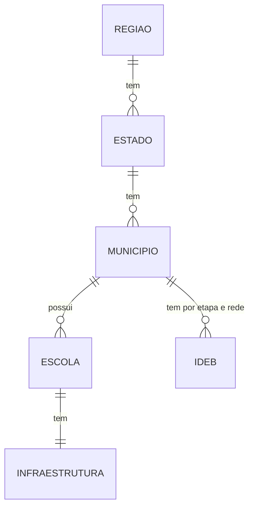

# Projeto de Banco de Dados — Fase 01: Descoberta e Requisitos

**Tema:** Educação e renda dos municípios
**Disciplina:** Banco de Dados I — Prof. Esp. Pedro Paz (AESA/CESA, ADS)
**Projeto da 2ª Avaliação — Entregável 01: Apresentação de Temas**
**Ano de referência dos dados:** 2023

**Equipe:** Felipe, Gabriel Alves, Ravi, Mayke Henan, Maria de Jesus 

>  **Antes do commit final:** procurar todos os `[__]`, `[ ]` e `[colar o link]` deste arquivo. Nada pode ir sem preencher.

---

## 1. Fluxo do trabalho executado

### 0. Storytelling

> *(rascunho, ajustar com o grupo)* Sabemos que municípios mais ricos tendem a ter melhor educação, mas será que isso sempre é verdade? Queremos descobrir quais municípios fogem desse padrão e o que eles têm em comum.

### 1. Identificação e descrição das fontes

| Fonte | Conteúdo | Como foi obtida | Arquivo |
|---|---|---|---|
| INEP, IDEB 2023 | IDEB por município, etapa e rede | Download (XLSX), tratado em Python | `dados/organizados/ideb_2023_municipios_organizado.csv` |
| INEP, Censo Escolar 2023 | Infraestrutura das escolas | Download (CSV de microdados) | `dados/organizados/censo_escolar_2023_publicas.csv` |
| IBGE, API de Localidades | Municípios, UFs e regiões | API (JSON) | `[arquivo da pessoa 3]` |
| IBGE, SIDRA | PIB dos municípios (disponível até 2023) | API | `[arquivo da pessoa 3]` |
| IBGE, SIDRA | População do Censo 2022 (a tabela não tem 2023) | API | `[arquivo da pessoa 3]` |
| Cruzamento IDEB × Censo | IDEB com infraestrutura agregada por município e rede | Gerado por `codigos/analise_resp4.py` | `dados/organizados/ideb_infra_municipio_2023.csv` |

**Recorte:** ano 2023; escolas públicas em atividade (137.914 de 217.625 escolas do Censo); IDEB das três etapas (anos iniciais, anos finais e ensino médio).

**Limitação a registrar:** a população vem do Censo 2022 e o PIB é de 2023 (diferença de 1 ano).

**Dicionário de dados:** [`docs/dicionario_de_dados.md`](docs/dicionario_de_dados.md). Colunas marcadas *(confirmar)* dependem da nota técnica do INEP.

### 2. Análise preliminar

#### Problemas encontrados nos dados

| # | Fonte | Problema | Quantidade | Tratamento |
|---|---|---|---|---|
| 1 | IDEB | IDEB sem valor (`-` na planilha original) | 6.343 de 40.682 linhas (15,6%): 2.642 nos anos iniciais, 2.263 nos finais, 1.438 no ensino médio | Convertido para nulo |
| 2 | IDEB | Notas de Matemática e Português com `ND` ou `--` | 149 (anos iniciais), 456 (finais) e 1.167 (ensino médio), em cada nota | Convertido para nulo |
| 3 | IDEB | A rede `Pública` é o **total** de Estadual + Municipal + Federal | 16.700 linhas (41% do arquivo) | Não somar as redes; escolher uma por análise |
| 4 | IDEB | Cobertura muito desigual por etapa e rede | Anos iniciais estaduais: 34,2% com IDEB; ensino médio municipal: 38,5% (104 linhas); ensino médio federal: 28,0% | Escolher etapa e rede com boa cobertura |
| 5 | IDEB | Linhas com nota Saeb mas sem IDEB | 8 linhas | Manter sem IDEB |
| 6 | IDEB | IDEB igual a 10 (teto da escala) | 2 linhas | Conferir se é valor real |
| 7 | IDEB × Censo | Município no IDEB e fora do Censo | 1: Boa Esperança do Norte (MT, 5101837) | Registrar; conferir com a lista do IBGE |
| 8 | IDEB × Censo | Código do município é texto no IDEB e número no Censo | todas as linhas | Converter para texto de 7 dígitos antes de juntar |
| 9 | Censo | Escolas paralisadas ou extintas, com nulos em `IN_*` | 37.395 (32.083 paralisadas + 5.312 extintas) | Excluídas pelo recorte (só em atividade) |
| 10 | Censo | `IN_BANDA_LARGA` vazio | 15.792 escolas, as mesmas com `IN_INTERNET` = 0 | Tratado como "não tem" |
| 11 | Censo | `QT_MAT_BAS` (matrículas) vazio em escolas em atividade | 993 (718 municipais e 275 estaduais) | Confirmar no dicionário do INEP |
| 12 | Censo | Arquivo original muito grande | mais de 400 colunas, 210 MB, 217.625 escolas | Lidas só 15 colunas |
| 13 | IDEB × Censo | A infraestrutura do Censo cobre todas as etapas da escola, mas o IDEB é por etapa | todas as linhas | Limitação registrada |
| 14 | IBGE | População de 2023 não existe na tabela | faltam 2007, 2010, 2022 e 2023 | Usar o Censo 2022 |

#### Conferência da chave de junção (código do município)

- Todos os códigos têm 7 dígitos nas duas fontes.
- Municípios distintos: IDEB **5.571** | Censo **5.570**.
- Códigos do Censo que não estão no IDEB: **0**. Códigos do IDEB que não estão no Censo: **1** (Boa Esperança do Norte, MT).
- Das 40.682 linhas do IDEB, **40.674 (99,98%)** encontraram infraestrutura correspondente no Censo.
- **Conclusão:** IDEB e Censo se cruzam pelo código do município.
- `[ ]` **Pendente:** conferir com a lista de municípios do IBGE (pessoa 3).

#### Linhas utilizáveis (IDEB e infraestrutura juntos)

| Etapa | Estadual | Municipal | Pública (total) |
|---|---|---|---|
| Anos iniciais | 1.190 | **5.241** | **5.430** |
| Anos finais | 3.554 | 3.195 | **5.382** |
| Ensino médio | **5.063** | 40 | **5.065** |

Melhores recortes: anos iniciais municipal, anos finais (rede pública total) e ensino médio estadual.

#### Entidades preliminares

Região, Estado, Município, Escola, Infraestrutura da escola e Indicador IDEB.



### 3. Definição de subtema

| # | Subtema | Ideia central | Os dados atuais permitem? |
|---|---|---|---|
| 1 | Infraestrutura escolar vs. desempenho | Municípios com mais estrutura vão melhor, mesmo sendo pobres? | Sim, no nível do município |
| 2 | Municípios que fogem do padrão | Quais municípios têm IDEB alto com renda baixa, e o que eles têm em comum? | Sim, usa as três fontes |
| 3 | Desigualdade dentro do mesmo município | A diferença entre a melhor e a pior escola é maior em cidades ricas ou pobres? | **Não**: o IDEB atual é por município, não por escola |

**Subtema escolhido:** `[confirmar com o grupo; sugestão: 2]`

**Justificativa (rascunho):** é o subtema que usa as três fontes (IBGE para renda, INEP para IDEB e infraestrutura), os dados já cruzam pelo código do município, e a pergunta "o que eles têm em comum" gera um banco com relacionamentos úteis entre território, escola e indicador.

**Perguntas que o banco deverá responder** *(rascunho, ajustado ao que os dados permitem)*:

1. Quais municípios com PIB per capita abaixo da mediana têm IDEB dos anos finais (rede pública) acima da mediana nacional?
2. Entre esses municípios, a proporção de escolas com biblioteca, internet e laboratório é maior do que nos municípios de renda baixa e IDEB baixo?
3. Dentro do mesmo município, a rede municipal e a estadual diferem em IDEB e em infraestrutura?

---

## 2. Divisão de responsabilidades

| Pessoa | Responsabilidade | Nome | Status |
|---|---|---|---|
| 1 | IDEB (INEP) | `[__]` | Feito |
| 2 | Censo Escolar (INEP) | `[__]` | Feito |
| 3 | IBGE (API, PIB e população) | `[__]` | PIB ok; população e municípios pendentes |
| 4 | Dicionário, problemas, entidades e conferência de códigos | Mayke Henan | Feito; falta a conferência com o IBGE |
| 5 | Slide, README, GitHub, reuniões e Classroom | Maria de Jesus | Em andamento |

**Fala do pitch (até 10 min):** Storytelling: `[__]` | Fonte: `[__]` | Análise: `[__]` | Subtema: `[__]`

---

## 3. Relatório resumido das reuniões

| Data | Participantes | O que foi discutido / decidido |
|---|---|---|
| `[__/__/2026]` | `[__]` | Escolha do tema Educação e renda dos municípios; divisão das responsabilidades |
| `[__/__/2026]` | `[__]` | `[__]` |

---

## 4. Uso de IA

Os scripts `codigos/analise_resp4.py` e `codigos/explorar_dados.py`, o dicionário de dados e os rascunhos de entidades foram elaborados com ajuda de IA (Claude, da Anthropic) e revisados pela equipe.

Link público da conversa: `[colar o link]`

---

## 5. Estrutura do repositório

```
educacao-renda-municipios/
|-- README.md
|-- dados/
|   |-- originais/
|   `-- organizados/
|-- codigos/
|   |-- analise_resp4.py
|   |-- resultado_resp4.txt
|   `-- [scripts das pessoas 1, 2 e 3]
|-- docs/
|   |-- dicionario_de_dados.md
|   `-- responsabilidade4.md
`-- slide/
    `-- apresentacao.pdf
```

---

## 6. Checklist final

- [ ] Repositório criado no GitHub (os 5 membros com acesso)
- [x] Responsabilidades divididas e registradas
- [ ] Dados do IBGE baixados via API
- [x] Dados do INEP baixados
- [ ] Código comentado, com aviso de uso de IA (falta no script da pessoa 1)
- [ ] Link público da conversa com a IA enviado
- [x] Dicionário de dados inicial e lista de problemas
- [ ] 3 subtemas, 1 escolhido e justificado
- [ ] Perguntas não triviais definidas
- [ ] Slide único + PDF do slide
- [ ] Ensaio do pitch com a fala dividida entre os 5
- [ ] Cópia dos dados originais e organizados
- [ ] Commit final feito (conferir o prazo com o professor)
- [ ] 1 membro respondeu no Classroom
