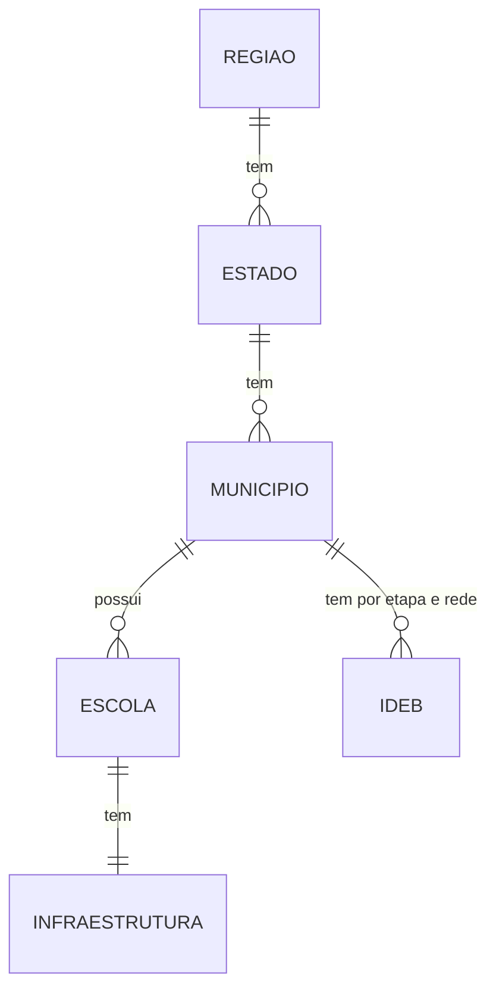

# Dicionário de Dados e Entidades (Responsabilidade 4)

**Tema:** Educação e renda dos municípios | **Ano de referência:** 2023 | **Fase 01**

> Colunas **conferidas nos arquivos reais** enviados pela equipe (IDEB e Censo Escolar). O IBGE ainda depende da pessoa 3. Itens com *(confirmar)* precisam ser checados na nota técnica/dicionário oficial do INEP.

## 1. IDEB 2023 por município (INEP) - arquivo `ideb_2023_municipios_organizado.csv`

40.682 linhas. Cada linha = **município + etapa + rede**. Origem: planilhas XLSX do INEP (anos iniciais, anos finais, ensino médio), organizadas pela pessoa 1.

| Coluna | Tipo | Descrição | Valores observados | Papel |
|---|---|---|---|---|
| `ETAPA` | texto | Etapa de ensino (coluna criada no tratamento) | Anos Iniciais, Anos Finais, Ensino Médio | parte da chave |
| `SG_UF` | texto | Sigla da UF | 27 UFs | |
| `CO_MUNICIPIO` | texto (7 dígitos) | Código do município (padrão IBGE) | 5.571 municípios distintos | parte da chave, **FK** |
| `NO_MUNICIPIO` | texto | Nome do município | | |
| `REDE` | texto | Rede de ensino | Estadual, Municipal, Federal, **Pública** (= total das três) | parte da chave |
| `VL_INDICADOR_REND_2023` | decimal | Indicador de rendimento (aprovação), de 0 a 1 | 0,41 a 1,00 | |
| `VL_NOTA_MATEMATICA_2023` | decimal | Nota de Matemática no Saeb | 124,27 a 406,40 | |
| `VL_NOTA_PORTUGUES_2023` | decimal | Nota de Língua Portuguesa no Saeb | 122,86 a 362,02 | |
| `VL_NOTA_MEDIA_2023` | decimal | Nota média padronizada (0 a 10) *(confirmar)* | 2,57 a 10,00 | |
| `VL_OBSERVADO_2023` | decimal | **IDEB observado** (indicador principal, 0 a 10) | 1,90 a 10,00; média 4,95 | |

**Chave:** `ETAPA + CO_MUNICIPIO + REDE` (sem duplicados, conferido).

## 2. Censo Escolar 2023 (INEP) - arquivo `censo_escolar_2023_publicas.csv`

137.914 linhas. Cada linha = **uma escola pública em atividade** (recorte de 217.625 escolas do arquivo original).

| Coluna | Tipo | Descrição | Valores |
|---|---|---|---|
| `CO_ENTIDADE` | inteiro | Código INEP da escola | **PK** (sem repetidos) |
| `NO_ENTIDADE` | texto | Nome da escola | |
| `CO_MUNICIPIO` | inteiro (7 dígitos) | Código do município | **FK** (no IDEB é texto: converter) |
| `NO_MUNICIPIO`, `SG_UF`, `NO_REGIAO` | texto | Município, UF e região | 5.570 municípios; 5 regiões |
| `TP_DEPENDENCIA` | código | 1 Federal, 2 Estadual, 3 Municipal (4 Privada fica fora do recorte) | no recorte: 706 / 29.783 / 107.425 |
| `TP_SITUACAO_FUNCIONAMENTO` | código | 1 em atividade (2 paralisada e 3 extinta ficam fora) | no recorte: só 1 |
| `TP_LOCALIZACAO` | código | 1 Urbana, 2 Rural | |
| `IN_BIBLIOTECA` | 0/1 | Tem biblioteca | 43.450 sim / 94.464 não |
| `IN_INTERNET` | 0/1 | Tem internet | 122.122 sim / 15.792 não |
| `IN_BANDA_LARGA` | 0/1 | Tem banda larga | 103.604 sim / 18.518 não / 15.792 vazio (= sem internet) |
| `IN_LABORATORIO_INFORMATICA` | 0/1 | Tem laboratório de informática | 40.911 sim / 97.003 não |
| `IN_LABORATORIO_CIENCIAS` | 0/1 | Tem laboratório de ciências | 13.818 sim / 124.096 não |
| `QT_MAT_BAS` | inteiro | Matrículas da educação básica *(confirmar)* | 993 vazios; máximo 36.811 |

## 3. Tabela cruzada - arquivo `ideb_infra_municipio_2023.csv`

Gerada por `analise_resp4.py`: as colunas do IDEB (seção 1) mais a infraestrutura **agregada por município e rede**.

| Coluna nova | Descrição |
|---|---|
| `PCT_IN_BIBLIOTECA`, `PCT_IN_INTERNET`, `PCT_IN_BANDA_LARGA`, `PCT_IN_LABORATORIO_INFORMATICA`, `PCT_IN_LABORATORIO_CIENCIAS` | % de escolas públicas da rede, naquele município, que têm o item (vazio contado como "não tem") |
| `N_ESCOLAS` | Quantidade de escolas da rede no município (base do percentual) |
| `TEM_INFRA` | Verdadeiro se achou escolas do Censo para aquele município e rede |

## 4. IBGE (pessoa 3)

| Fonte | Situação |
|---|---|
| API de Localidades (município, UF, região) | Aguardando o arquivo |
| PIB dos municípios | Disponível até 2023 (informado pela pessoa 3) |
| População | 2023 não existe na tabela do IBGE; usar o **Censo 2022** (limitação a registrar) |

Estrutura esperada da API de Localidades (JSON aninhado): `id` (código de 7 dígitos), `nome`, `microrregiao`, `microrregiao.mesorregiao.UF` (`id`, `sigla`, `nome`) e `microrregiao.mesorregiao.UF.regiao`. O `explorar_dados.py` já "achata" esse JSON.

## 5. Entidades e relacionamentos

| Entidade | Atributos | Chave | Fonte |
|---|---|---|---|
| Região | id, sigla, nome | id | IBGE / Censo |
| Estado | id, sigla, nome, região | id | IBGE |
| Município | código (7 dígitos), nome, UF, PIB 2023, população (Censo 2022) | código | IBGE |
| Escola | CO_ENTIDADE, nome, município, dependência, localização, matrículas | CO_ENTIDADE | Censo |
| Infraestrutura | biblioteca, internet, banda larga, lab. informática, lab. ciências | CO_ENTIDADE (+ ano) | Censo |
| Indicador IDEB | município, etapa, rede, indicador de rendimento, notas, IDEB observado | município + etapa + rede | IDEB |

